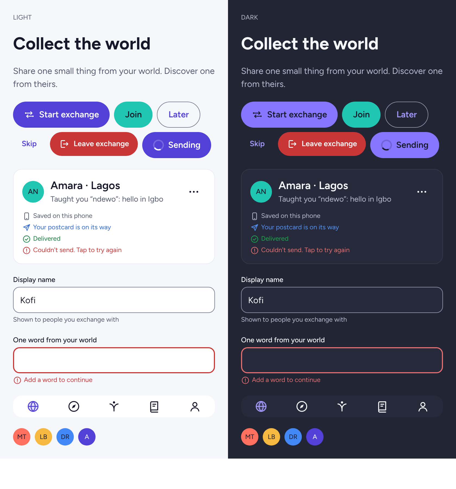

# @yuhshi/ui

Yuhshi component library for Android, iOS and web (React Native + react-native-web), built only from `@yuhshi/tokens` and the Yuhshi UI icons (`YuhshiWorld/yuhshi-icons`).



## Components (v0.1)

| Component | What it guarantees |
| --- | --- |
| `ThemeProvider`, `useTheme` | Light/dark follows the device; users can force either |
| `Text` | Semantic typography tokens only; headings announced as headings; grows with system text size up to 200%; tabular numerals for data |
| `Icon` | Yuhshi UI icons; decorative by default (hidden from screen readers), announced when given a `label`; selected tint for tabs; back/forward mirror in RTL |
| `Button` | primary, connection, secondary, ghost, destructive; every label ≥ 4.5:1 in both themes; ≥ 44 px touch target; loading blocks repeat taps and reports busy |
| `IconButton` | 44 × 44 target; an accessibility label is required by the type system |
| `Card` | Neutral surface; colour stays reserved for meaning |
| `TextField` | Visible label (placeholders are never labels); control border ≥ 3:1; errors shown with icon and words, announced politely |
| `SyncStatus` | Honest statuses in postcard language (E7); icon + words, never colour alone; only server-confirmed states read as final |
| `Avatar` | Initials in any script on the person's personal hue (E2), with readable ink chosen automatically; no badges, ranks or counts |

## Commands

```sh
pnpm typecheck
pnpm test                                        # 34 logic, contrast and accessibility tests
npx vitest run --config preview/vitest.config.ts # regenerate preview/gallery.html
```

## Notes

- Fonts: apps load Figtree with `@expo-google-fonts/figtree`; family names are in `src/fonts.ts`.
- Button labels use `label.button` (16/600) and `label.buttonSmall` (14/600), engineering defaults pending owner review (the locked `label.control` is 13/500).
- Spacing, radii, touch targets and motion come from `@yuhshi/tokens` layout tokens, also engineering defaults pending owner review.
